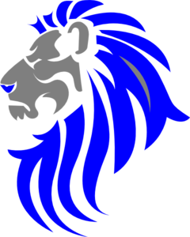
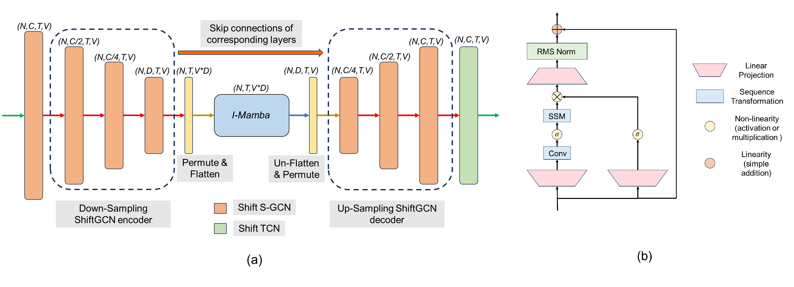

# Simba 
This is the official implementation of our paper [Simba: Mamba augmented U-ShiftGCN for Skeletal Action Recognition in Videos](https://arxiv.org/abs/2404.07645). To the best of our knowledge, this is the first skeleton action recognition model based on Mamba augmentation with GCN. 

## News

- [ ] Make pre-trained models available.
- [ ] This repo borrows inspiration from multiple codebases. Therefore, some files are redundant. Working towards cleaning the repo !
- [x] Make the code available.

## Simba architecture
<p align="center">
   
</p>

# Preparation
### Install torchlight
Run `pip install -e torchlight`
### Install dependencies
```
pip install -r requirements.txt
```

### Download datasets.

#### There are 3 datasets to download:

- NTU RGB+D 60 Skeleton
- NTU RGB+D 120 Skeleton
- NW-UCLA

#### NTU RGB+D 60 and 120

1. Request dataset here: https://rose1.ntu.edu.sg/dataset/actionRecognition
2. Download the skeleton-only datasets:
   1. `nturgbd_skeletons_s001_to_s017.zip` (NTU RGB+D 60)
   2. `nturgbd_skeletons_s018_to_s032.zip` (NTU RGB+D 120)
   3. Extract above files to `./data/nturgbd_raw`

#### NW-UCLA

1. Download dataset from [CTR-GCN](https://github.com/Uason-Chen/CTR-GCN)
2. Move `all_sqe` to `./data/NW-UCLA`

### Data Processing

#### Directory Structure

Put downloaded data into the following directory structure:

```
- data/
  - NW-UCLA/
    - all_sqe
      ... # raw data of NW-UCLA
  - ntu/
  - ntu120/
  - nturgbd_raw/
    - nturgb+d_skeletons/     # from `nturgbd_skeletons_s001_to_s017.zip`
      ...
    - nturgb+d_skeletons120/  # from `nturgbd_skeletons_s018_to_s032.zip`
      ...
```

#### Generating Data

- Generate NTU RGB+D 60 or NTU RGB+D 120 dataset:

```
 cd ./data/ntu # or cd ./data/ntu120
 # Get skeleton of each performer
 python get_raw_skes_data.py
 # Remove the bad skeleton 
 python get_raw_denoised_data.py
 # Transform the skeleton to the center of the first frame
 python seq_transformation.py
```

# Evaluation

```
bash evaluate.sh
```
Replace path_to_model_weights argument to the saved model weights you obtain after training.
# Training & Testing

### Training

```
bash train.sh
```

Please check the configuration in the config directory.

### Testing

```
bash evaluate.sh
```

To ensemble the results of different modalities, run the following command:

```
bash ensemble.sh
```

## Acknowledgements

This repo is based on [Hyperformer](https://github.com/ZhouYuxuanYX/Hyperformer), [Mamba](https://github.com/state-spaces/mamba) and [Shift-GCN](https://github.com/kchengiva/Shift-GCN).

Thanks to the original authors for their work!

## Citation

Please cite this work if you find it useful:
````BibTeX
@article{chaudhuri2024simba,
  title={Simba: Mamba augmented U-ShiftGCN for Skeletal Action Recognition in Videos},
  author={Chaudhuri, Soumyabrata and Bhattacharya, Saumik},
  journal={arXiv preprint arXiv:2404.07645},
  year={2024}
}
````

# Contact
For any questions, feel free to raise an issue !


## AutoDL baseline compatibility

This checkout restores the official Simba sources at
`bb0f5254aeecd000d460db4776d4f4bd43bd7f9f`, retaining the local AutoDL compatibility layer.
It is not byte-for-byte identical to upstream. The negative-eigenvalue experiment,
its CUDA extension, configurations, diagnostics and launcher have been removed.

Retained changes are NTU 25-joint dimension compatibility in `layers.py` and
`model/Hyperformer.py`, valid-frame detection in the NTU feeder, causal-conv1d 1.7
API compatibility, the minimal MambaBlock wrapper, and training/data-loader,
checkpoint and RNG recovery support. Original positive Mamba state transitions
are used. The official dataset configurations are restored; `train.sh` and
`test.sh` retain the local NTU60 X-Sub joint AutoDL entry point.

On the existing AutoDL Linux PyTorch environment:

```bash
python -m pip install -r requirements-autodl.txt
MAX_JOBS=2 python setup_baseline_scan.py build_ext --inplace
python -c "import torch, selective_scan_cuda as m; print(m.__file__); print(m.fwd.__doc__)"
```

Build the baseline extension from these sources to avoid loading an installed
extension with an incompatible API. PyTorch, CUDA toolkit and driver must be
compatible. The build defaults to the visible GPU architecture; an explicit
`TORCH_CUDA_ARCH_LIST=8.6` is suitable for RTX 3080 Ti and `8.9` for RTX 4090
when supported by the installed CUDA toolkit.

The retained configuration is `config/nturgbd-cross-subject/joint_autodl.yaml`.
It references `/root/autodl-tmp/ntu60/ntu/NTU60_CS.npz`. Keep the same processed
data file as previous baseline runs. `tools/prepare_ntu60_xsub.py` is retained
for data preparation, and `tools/training_rng.py` for checkpoint recovery.
Dataset files and training outputs are not included. No new experiment or
training schedule is introduced in this restoration.

## MTI screening experiment

Current experiment: [Combination1 short10](COMBINATION1_EXPERIMENT.md),
Hyper-GCN spatial + DeGCN temporal adapters. Only the combined variant is launched;
the previous verified short10 baseline is reused. Includes AutoDL background,
checkpoint resume and cancellable shutdown after a 5-minute delay.

The optional `model_args.use_mti` switch adds only the temporal MTI module from
TSkel-Mamba. It defaults to false. See [MTI_EXPERIMENT.md](MTI_EXPERIMENT.md)
for the paper attribution, explicit adaptation conventions, paired fixed-LR
15-epoch BF16 AMP protocol, AutoDL background commands and checkpoint recovery.
